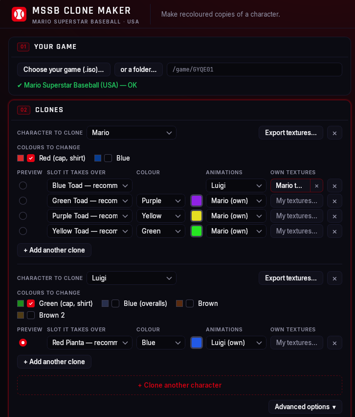

# MSSB Clone Maker

**Put extra copies of your favourite characters into Mario Superstar Baseball.** Four Marios in
four colours, a team of King Boos, a Peach in your own painted outfit, a Mario who moves like
Luigi: the Clone Maker builds a new copy of your game where other characters' slots hold the
clones you design. Play it in Project Rio or Dolphin.

  <a href="https://github.com/Cjericho4/mssb-modding/releases/latest"><b>⬇ Download the latest release</b></a>
  &nbsp;·&nbsp; Windows and Mac &nbsp;·&nbsp;
  <a href="tools/clonemaker/README.md">User guide</a>
  &nbsp;·&nbsp;
  <a href="https://github.com/Cjericho4/mssb-modding/issues/new/choose">Report a problem</a>

  

> **Beta.** Clones of Mario, Peach, King Boo and Donkey Kong, and games mixing several of them, have
> been played in Project Rio. See the [known issues](tools/clonemaker/README.md#known-issues).

## What you can do

- **Clones in any colour.** Pick a character, pick which slots it takes over, and give each copy its
  own colour. A preview shows every texture before and after.
- **Several characters in one game.** Mario recolours on the Toad colours and King Boos on the Shy
  Guy colours, all at once.
- **Your own textures.** Export a character's textures as pictures, paint them in any paint
  program, and give a clone your version.
- **The real thing, not just a skin.** Each clone gets its character's voice, size, stats and
  chemistry, and its name and picture in the menus.
- **Animations from another character.** Make a clone move like someone else (characters whose
  skeleton fits are offered).
- **Open characters in Blender.** Export any character's textured model, skeleton and animations
  to a file Blender opens.
- **Safe.** Your original game is never changed; the Clone Maker saves a new `.iso` next to it.

## Quick start

1. **Download** `MSSB-Clone-Maker.exe` (Windows) or `MSSB-Clone-Maker-Mac.zip` (Mac) from the
   [latest release](https://github.com/Cjericho4/mssb-modding/releases/latest). Nothing to install.
2. **Choose your game**: your own Mario Superstar Baseball (USA) `.iso`.
3. **Set up your clones**: the character to clone, the slots it takes, a colour for each.
4. **Create patched game**, then open the new `.iso` in Project Rio or Dolphin and put the clones on
   your team.

The [user guide](tools/clonemaker/README.md) walks through every option, with troubleshooting.
The app shows a **New version** button when an update is out, and a **Feedback** button to report
problems or ideas.

You need your own copy of the game. Nothing here contains game files, and the Clone Maker never
uploads or shares yours. Play the patched game offline: Rio's online and ranked modes expect the
original game.

---

## For developers

This repository also holds the tools the Clone Maker is built on. They rely on what the
[mssb-dtk](https://github.com/Cjericho4/mssb-dtk) decompilation found out about the game.

| Folder | What it is |
|---|---|
| `tools/clonemaker` | The Clone Maker: Rust core (`core/`) and Tauri window (`app/`) for Windows, Mac and Linux. Contract between them: [API.md](tools/clonemaker/API.md); design notes: [core/README.md](tools/clonemaker/core/README.md). |
| `tools/datamap` | List, extract and replace the game's files; stats, sounds and animations ([README](tools/datamap/README.md)). |
| `tools/modding` | The original Python clone patcher (the reference the Rust core is tested against), the recolour audit and small inspectors. |

Test builds of every change are under [Actions](https://github.com/Cjericho4/mssb-modding/actions)
(artifacts, GitHub login needed).

### Making a release

1. Set the same new version in `tools/clonemaker/app/tauri.conf.json` and `tools/clonemaker/app/Cargo.toml`
   (and the `mssb-clone-maker` entry in its `Cargo.lock`).
2. Write the release notes: copy [release-notes/TEMPLATE.md](release-notes/TEMPLATE.md) to
   `release-notes/v0.2.0.md` and fill it in (what's new, fixes, known issues, how to update).
   Update the [Known issues](tools/clonemaker/README.md#known-issues) in the user guide to match.
3. Commit and push, then `git tag v0.2.0 && git push origin v0.2.0`. Both build workflows check that the
   tag matches the version and that the notes file exists, run the tests, and publish the release
   `v0.2.0` with those notes, the Windows exe and the Mac zip.

### How it relates to mssb-dtk

The game knowledge (addresses, table layouts, formats, the evidence behind them) lives in the
decompilation repository's `.agent/` docs; a comment here that says `.agent/stats.md` means
[that file in mssb-dtk](https://github.com/Cjericho4/mssb-dtk/tree/main/.agent). Developer helpers that
read the decompilation (e.g. `tools/datamap/dev_tables.py`) expect a built mssb-dtk checkout next
to this one (`../mssb-dtk`) or at `$MSSB_DTK`.

Put the extracted game at `orig/GYQE01/` (ignored by git) for the tests that need it, e.g.
`python3 tools/clonemaker/difftest.py`.

## License

MIT (see [LICENSE](LICENSE)). The bundled fonts are under the SIL Open Font License (their
`OFL-*.txt` files). Mario Superstar Baseball and its characters belong to Nintendo; this project is
not affiliated with Nintendo.
