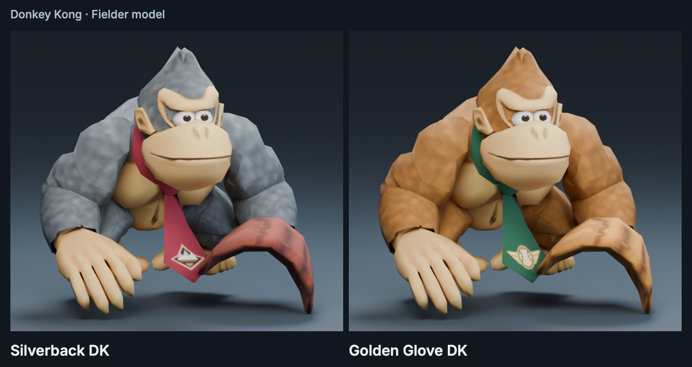
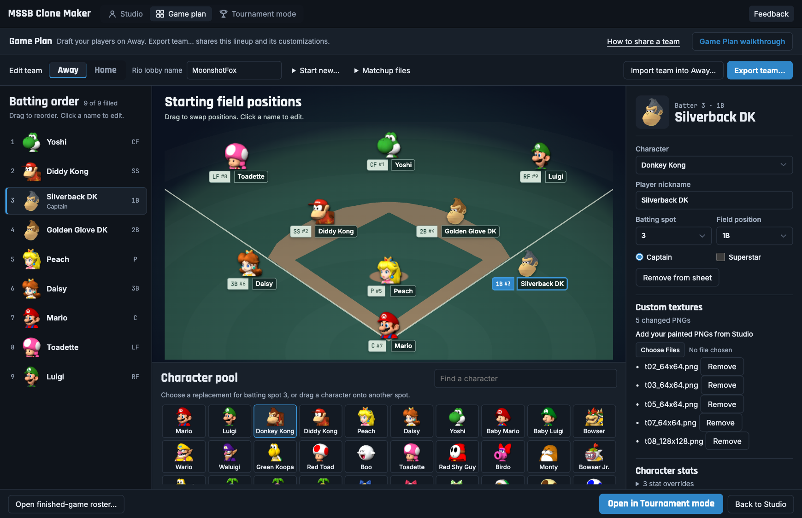
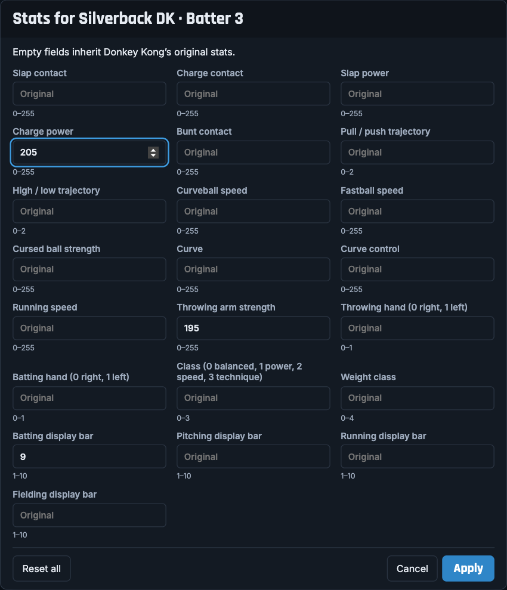
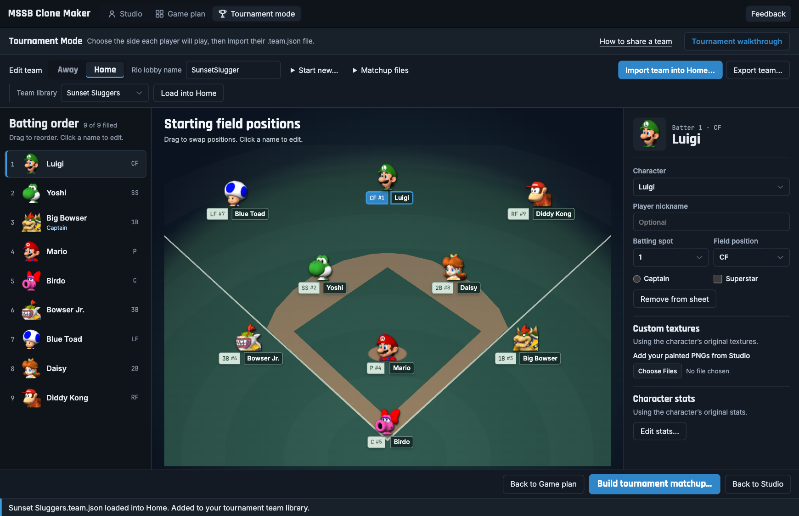

# MSSB Clone Maker — Bring your own team

*Apple silicon beta · Changes since v0.4.0-beta*

Each player can now build a team in Game Plan and send it to a tournament organizer as one file. The organizer picks the matchup. Both players can then take the same batting orders and starting defense into a private Project Rio game.

## Draft your nine in Game Plan

Clone Maker opens in Studio. Choose **Game Plan → Plan my team** to start with nine open spots. Drag a batter up the order or move a fielder across the diamond. Edit a nickname in either view and it appears in both. Your draft saves as you go, even with spots left to fill.

**Export team…** makes a single `.team.json` file you can send to the organizer. It carries your lineup, positions, captain and superstar choices, nicknames, stat edits, and painted textures. The game image and original textures stay on your computer. You can draft and share a team before choosing a disc.

## Give two DKs different jobs

Give Silverback more charge power for the middle of the order. Give Golden Glove more speed to cover ground at second. Each clone has 22 editable fields. Blank fields keep their inherited values, and the four menu rating bars can be set independently of gameplay.

You can also paint a different look for each copy. Load portraits once from your own game, and the lineup and field show each clone’s custom head in both planning modes.

To make both looks from your own DK texture export, use the [showcase paint kit](game-plan-and-tournament/dk-paint-kit.zip).

## Run a matchup in Tournament Mode

Pick **Away** or **Home** and choose **Import team into Away…** or **Import team into Home…**. Only that side changes. Imported teams stay in your **Team library**, ready for the next round. Save the whole matchup when you want to keep both sides together. Both modes include a walkthrough.

For a private Project Rio **No Game Mode** lobby, each player builds the shared matchup with their own clean USA disc image. Clone Maker assigns compatible slots for duplicate characters and creates the game image and Rio lineup file. Compare matchup IDs before first pitch.
