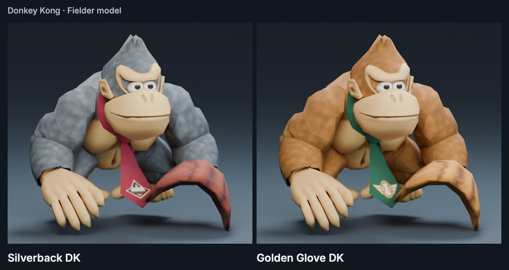
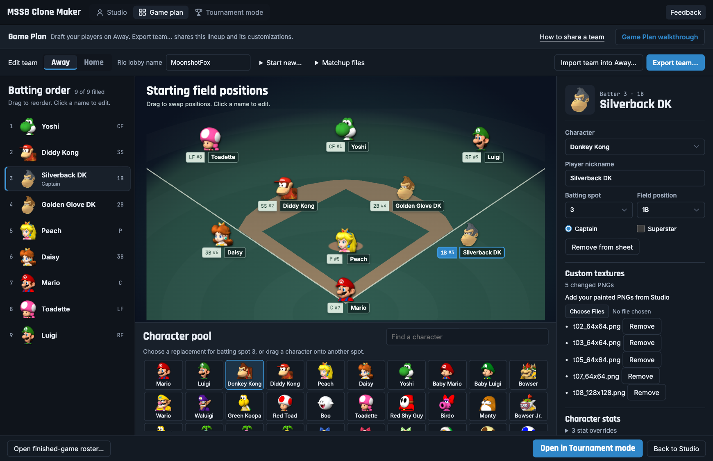
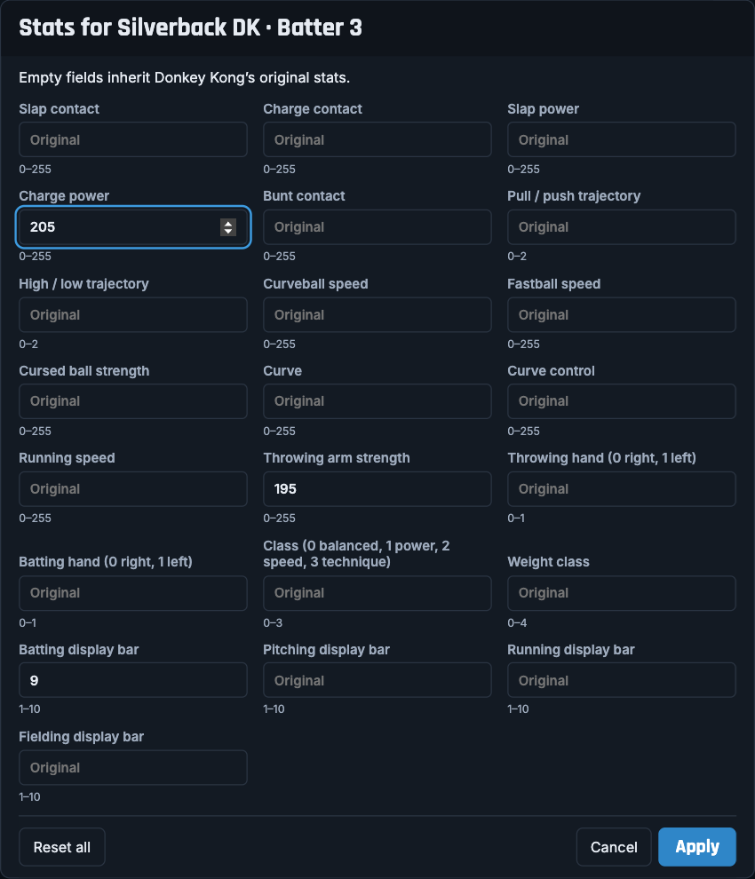
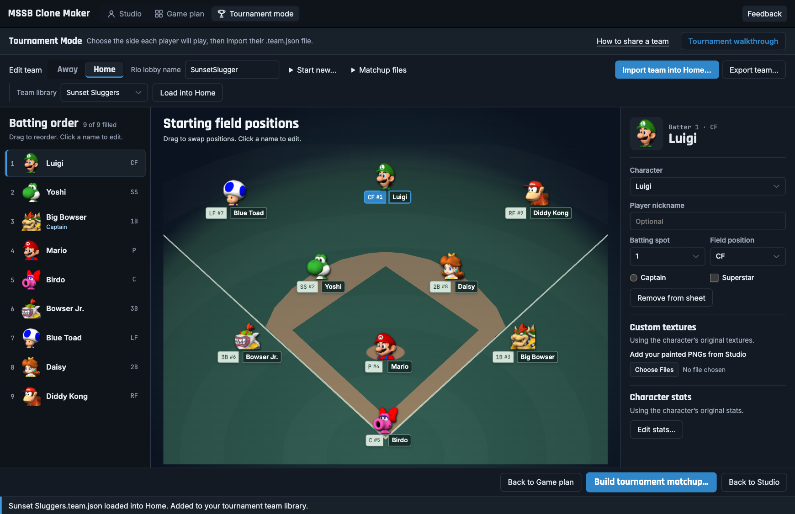

# MSSB Clone Maker 0.7.0

*Changes since v0.4.0-beta*

You can now make your team in Game Plan and send it to whoever’s running the tournament. They can load your lineup without picking all nine players again.

## Game Plan

Open **Game Plan → Plan my team** from Studio. You start with nine empty spots. Drag players into batting order or drop them where you want them on the field. Click a name in either view to change it. The draft saves as you go, so you can pick a few players and finish later.

**Export team…** saves one `.team.json` file with your batting order, field positions, captain, superstar picks, nicknames, stat changes and any textures you painted. You don’t need a disc to make or share a team. Your ISO and the game’s original textures stay on your computer.

## Clone stats and textures

**Stat editing is only partially tested.** Edits save and load with a team sheet. We haven’t checked every stat in a live game yet.

The example team has two DKs. Silverback bats third and plays first, with charge power set to 205. Golden Glove bats cleanup and plays second, with running speed set to 185. Each clone has 22 editable fields. Leave a field blank to keep its original value. The four rating bars on the character menu have their own settings.

Once you load portraits from your own game, each DK’s painted colors show up in the batting order and on the field in both modes. The [DK paint kit](https://raw.githubusercontent.com/Cjericho4/mssb-modding/05e34b8977abdf333845ecfef2fe9c8f5cc14d1b/release-notes/game-plan-and-tournament/dk-paint-kit.zip) makes both looks from your own DK texture export.

## Tournament Mode and Project Rio

Pick **Home** or **Away**, then import that player’s team. The other lineup stays put. If the player advances, you can load their team from the **Team library** for the next round. You can also save both teams together as one matchup. Game Plan and Tournament Mode each have a walkthrough.

To play the matchup in a private Project Rio **No Game Mode** lobby, both players build it with their own clean USA ISO. Clone Maker finds slots for duplicate characters and writes the batting orders and starting positions to Rio’s lineup file. Compare matchup IDs to check that you’ve both loaded the same matchup.
