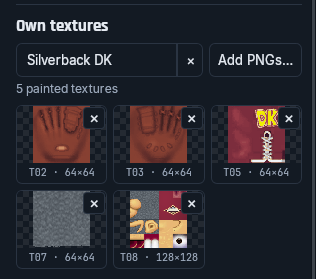
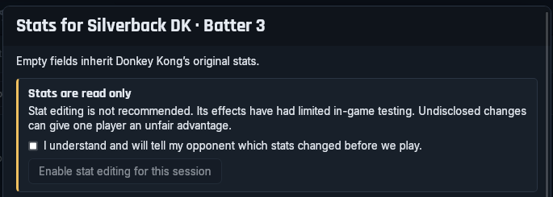

# MSSB Clone Maker 0.7.1

## Painted textures in Game Plan and Tournament Mode

Select a player and choose **My textures…** under **Own textures**, just as you would in Studio. Pick the folder you painted. Clone Maker skips the unchanged pictures from the original export and shows a thumbnail for each painted one. Click a thumbnail to see it at full size, or use **Add PNGs…** to change one picture. You can still do this before choosing a game disc.

## Custom stats are locked by default

You can check a clone’s stats in Studio, Game Plan, or Tournament Mode without enabling editing. If a team already has custom stats, you can see those values. Tournament Mode also shows which side has changes.

**We don’t recommend editing stats.** In-game testing is limited, and undisclosed changes can give one player an unfair advantage. To edit, you must acknowledge that you’ll tell your opponent which stats changed before play, then choose **Enable stat editing for this session**. You can lock it again at any time after applying or canceling your edits. It locks again when you reopen the Cloner.

